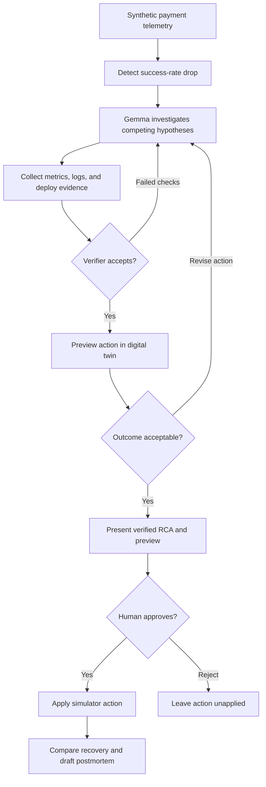

# 🛡️ ProofLine

### The AI on-call engineer for payments that proves its answers.

**Hacktober Hack Day · Track: Best Use of Google Gemma**

When payments fail, every minute costs money. The hard part is figuring out **why**. ProofLine is an AI on-call agent designed to investigate payment incidents using local Gemma 4 inference, test competing hypotheses against telemetry, verify its conclusions in code, and propose a fix that requires human approval.

> **AI that proposes. Code that decides. Humans that approve.**

## Why ProofLine?

A falling payment success rate can mean a bad deployment, an unavailable bank, a traffic spike, or a surge in customer-side declines. Similar alerts require very different responses. An on-call engineer needs to establish when the failure began, which services are affected, what evidence supports the diagnosis, and whether a proposed action will help.

ProofLine brings that investigation into one workflow. Its primary users are on-call SREs and payments engineers. Engineering managers receive impact estimates and postmortem drafts; operations teams receive a clear explanation of technical versus business declines.

## Investigation workflow



The planned agent lifecycle is:

```text
TRIAGE → INVESTIGATE → CONCLUDE → VERIFY → PREVIEW → PROPOSE
       → AWAIT_APPROVAL → REMEDIATE → COMMS → POSTMORTEM
```

Investigations have explicit budgets: **10 tool calls, 3 verification attempts, 30 seconds per model call, and 90 seconds overall**. When evidence or time is insufficient, the agent returns `inconclusive` with its best partial evidence.

## Planned capabilities

| Capability | Intended behavior |
| --- | --- |
| Automatic detection | Open incidents when a sustained success-rate drop crosses a deterministic threshold. |
| Hypothesis board | Track deployment, bank outage, traffic, configuration, and business-decline explanations with evidence-backed status changes. |
| Live investigation | Stream concise investigation summaries, tool calls, results, and verifier verdicts. |
| Verified RCA | Require valid evidence references and passing rules before presenting a final root-cause conclusion. |
| Fix Preview | Test a proposed action in a forked simulator and overlay predicted recovery on the chart. |
| Decline triage | Separate infrastructure failures from wrong PIN, insufficient funds, and limit-related declines. |
| Chaos Mode | Hide a randomly chosen fault, reveal ground truth after investigation, and score the answer. |
| Voice war-room | Ask follow-up questions in English, Hindi, or Hinglish using read-only tools. |
| Multimodal evidence | Read synthetic bank bulletin images and compare their claims with telemetry. |
| Impact reporting | Calculate failed transactions, money at risk, and estimated loss avoided against a labeled baseline. |
| Communications | Draft internal, merchant, and customer updates in English and Hindi for review. |
| Postmortems and replay | Generate an incident timeline and narrative; replay recorded runs through the dashboard. |
| Evaluation board | Publish seeded results and verifier-on/off comparisons. |

## Architecture

ProofLine separates model reasoning from deterministic detection, evidence checks, approval enforcement, and simulator execution.

| Component | Responsibility |
| --- | --- |
| Dashboard | Health chart, bank tiles, KPIs, hypotheses, tool stream, evidence drawer, RCA, approvals, and evaluation board. |
| Payment simulator | Generate transactions, decline codes, logs, metrics, and deployment history on a controllable clock. |
| Incident detector | Compare recent success rates with baseline, debounce alerts, and estimate incident onset. |
| Agent orchestrator | Run the bounded lifecycle and expose a fixed tool set to Gemma. |
| Model gateway | Handle inference, warm-up, streaming, malformed output recovery, timeouts, and failure isolation. |
| Deterministic verifier | Validate evidence, chronology, affected scope, decline classification, and action consistency. |
| Digital twin | Snapshot simulator state and compare candidate fixes against a no-action branch. |
| Approval layer | Validate incident-bound and action-bound approval before idempotent execution. |
| Recorder and evaluation harness | Record events, replay runs, compare against ground truth, and generate reports. |

The PRD proposes TypeScript contracts, Zustand frontend state, vectorized simulation, DuckDB-backed telemetry queries, a WebSocket event stream, and an Ollama/llama.cpp model gateway. These choices require implementation and runtime validation.

Shared **contract version 2** is intended to establish schemas and fixtures before integration. Events cover metrics, incidents, hypotheses, evidence, actions, twin previews, impact, communications, voice, and Chaos Mode.

## Payment simulation and scenarios

```text
gateway → payment-orchestrator → upi-service → bank-adapter
                                             ├── BANK_X
                                             ├── BANK_Y
                                             └── BANK_Z

Background services: wallet, notification-service
```

Banks represent synthetic acquiring-side partner/PSP banks. Money is stored in integer paise, with an approximate average ticket of ₹450 in the proposed simulation.

| Category | Synthetic codes | Interpretation |
| --- | --- | --- |
| Technical | `TD_TIMEOUT`, `TD_BANK_5XX`, `TD_RATE_LIMITED` | Infrastructure or service-side failures. |
| Business | `BD_WRONG_PIN`, `BD_LIMIT_EXCEEDED`, `BD_INSUFFICIENT_FUNDS` | Customer or transaction constraints that do not automatically imply broken infrastructure. |

These are project-defined codes, not official NPCI codes. The dashboard should show raw success rate and technical success rate, which excludes business declines.

Each scenario is deterministic given `(seed, scenario, fault_offset, severity)` and has known ground truth.

| ID | Scenario | Expected investigation | Phase |
| --- | --- | --- | --- |
| S0 | Healthy traffic | Avoid false incidents. | 1 / evaluation |
| S1 | Bad deploy | Identify deploy `#482`, which reduces BANK_X timeout from 3000 ms to 800 ms; propose rollback. | 2 |
| S2 | Bank outage | Diagnose increased BANK_X latency and 5xx failures; cross-check its bulletin. | 3 |
| S3 | Decoy deployment | Rule out an unrelated notification-service deploy that occurs after the BANK_X failure begins. | 3 |
| S5 | Business-decline surge | Recognize limit-related declines with healthy infrastructure; recommend communication. | 3 |
| S4 | Traffic spike | Diagnose gateway rate limiting under threefold load. | 4, stretch |
| S6 | Compound fault | Identify a bad deploy and separate BANK_Y degradation with distinct evidence. | 4, stretch |

## Verification: three gates before action

The agent submits a structured conclusion containing `cause`, `confidence`, `evidence_ids`, `ruled_out`, `proposed_action`, and `summary`. Confidence alone cannot authorize a conclusion or action.

1. **Evidence gate:** every cited evidence ID resolves to a real record.
2. **Logic gate:** timing, service path, scope, decline category, and proposed action support the explanation.
3. **Outcome gate:** an operational fix predicts recovery in a forked simulator before approval.

| Planned check | Purpose |
| --- | --- |
| `evidence_exists` | Reject missing or invented evidence references. |
| `deploy_precedes_dip` | Reject deployments that occurred after the failure began. |
| `deploy_on_failing_path` | Reject unrelated service changes. |
| `scope_concentration`, `others_healthy` | Check affected and unaffected comparison groups. |
| `no_internal_cause`, `traffic_elevated` | Validate cause-specific conditions. |
| `action_matches_cause` | Reject incompatible remediations. |
| `decline_class_matches` | Match technical or business explanations to observed declines. |
| `external_claim_consistent` | Compare bulletin claims with telemetry. |
| `twin_predicts_recovery` | Require a successful preview for an operational fix. |

A business-decline diagnosis requires at least 70% business declines with technical success rate within baseline. Failed checks return machine-readable reasons to the agent; verifier rejections are displayed and counted.

## Fix Preview and human approval

The twin snapshots configuration, RNG state, clock, and buffers, then runs action and no-action branches for **120 simulated seconds**. It returns predicted success-rate series, expected recovery time, and a `recovers` flag.

The simulator action allowlist is `rollback_deploy`, `failover_bank`, `enable_circuit_breaker`, `scale_gateway`, and `notify_only`.

Execution requires a **single-use approval token bound to `(incident_id, action_id)`, expiring after five minutes**. Remediation must be idempotent. After execution, the dashboard compares actual recovery with the preview.

**Contract question:** the PRD permits `notify_only` when infrastructure is healthy while requiring recovery previews for fixes. Implementation must define the outcome gate for communication-only recommendations, which cannot repair customer-side constraints.

Stakeholder messages remain drafts for review. The demo does not send messages to real stakeholders.

## Gemma integration

**Target model: local Gemma 4 E4B**, with quantization and runtime behavior validated on the demo laptop.

| Intended capability | ProofLine use |
| --- | --- |
| Function calling | Query telemetry, update hypotheses, request previews, and submit conclusions. |
| Local inference | Keep investigation telemetry on the demo machine in the default flow. |
| Audio input | Push-to-talk incident questions with clips up to 30 seconds. |
| Image input | Extract structured claims from synthetic bank bulletin images. |
| Multilingual responses | English, Hindi, and Hinglish follow-ups; English/Hindi communication drafts. |
| Optional deeper reasoning | Spend additional reasoning time on conclusions within latency limits. |

The target hardware in the PRD is an **Intel i5 12th-generation laptop, 16 GB RAM, and RTX 3050 with 6 GB VRAM**. Model fit, tool calling, audio, vision, and latency must be measured on the chosen runtime before claiming support.

Native audio is a planned integration spike. The proposed fallback uses browser speech recognition followed by a text query; spoken answers use browser speech synthesis. Browser speech services may require a network connection, so the fallback needs separate offline testing. Optional remote larger-model inference also changes the local-only data boundary.

## Impact and evaluation

Impact is computed in code from affected scope, failure percentage, failed transaction count, and money at risk per minute.

```text
estimated_saved_paise = counterfactual_loss_paise − actual_loss_paise
```

The counterfactual assumes the fault persists at the measured failure rate for a configurable manual response time, defaulting to **25 minutes**. This assumption must remain visible. The result is a simulated estimate rather than measured production revenue saved.

### Acceptance targets

These are PRD targets, not published benchmark results.

| Metric | Target |
| --- | --- |
| Detection trigger | 30-second success rate falls ≥5 percentage points below the 5-minute baseline for ≥10 seconds. |
| Detection latency | ≤12 simulated seconds. |
| Verified RCA time | Median ≤45 seconds; p90 ≤75 seconds on local E4B. |
| Fix Preview | ≤300 ms wall time per action. |
| Voice response start | ≤8 seconds after microphone release. |
| Root-cause accuracy | ≥90% for S1, S2, S3, and S5. |
| Healthy baseline | Zero false incidents in S0 evaluation. |
| Evaluation coverage | ≥40 seeded runs across the primary fault scenarios. |
| Demo twin accuracy | Actual recovery within ±3 seconds of prediction. |
| Offline readiness | Core demo works with network disconnected. |

The evaluation harness should also report decoy-clearing rate, correct handling of business declines, false-incident rate, tool calls, verifier rejection rate, and prediction error. Planned ablations compare **verifier on vs off** and **E4B vs E2B**, with a larger remote model optional.

Results should appear in the Eval Board and dated reports under the planned `eval/results/` directory. Failed and inconclusive runs should remain visible in the results.

## Build roadmap

| Phase | Deliverables | Exit condition |
| --- | --- | --- |
| **1 — Foundation** | Contracts, fixtures, simulated clock, telemetry, S1 fault, reset, snapshot/fork primitives, live dashboard. | S1 changes health; reset restores baseline; determinism passes; S0 remains healthy. |
| **2 — Verified investigation** | Detector, tools, model gateway, agent lifecycle, verifier, impact, approval, remediation. | Real-model S1 completes detect → investigate → verify → approve → recover three consecutive times. |
| **3 — Differentiators** | Bank outage and decoy, Fix Preview, business declines, Chaos Mode, savings, voice, bulletin evidence. | Primary scenarios pass repeated runs; Chaos Mode and voice or fallback work in rehearsal. |
| **4 — Evaluation and polish** | Evaluation and ablations, communications, postmortems, replay, failure handling, presentation checks. | Evaluation evidence is published and the readiness checklist passes. |

Stretch goals include traffic spikes, compound faults, a skeptic pass, incident memory, screenshot questions, and simulator-generated training traces. Core priorities are the verifier, decoy scenario, Fix Preview, Chaos Mode, and honest evaluation.

## Repository and setup

### Available now

```text
hacktoberfest-proofline/
├── README.md       # Project overview and roadmap
└── prd (1).md      # Detailed v2 requirements
```

### Planned source layout

```text
frontend/           # Dashboard and event-driven UI
backend/            # Simulator, detector, agent, verifier, approvals, model gateway
contracts/          # Shared schemas, types, fixtures, and changelog
eval/               # Seeded evaluation harness and results
```

These directories do not exist yet. The PRD also references `design.md` and `CLAUDE.md`; those companion files have not been added to this repository.

### Clone the project

```bash
git clone https://github.com/Aashutosh-Mahajan/hacktoberfest-proofline.git
cd hacktoberfest-proofline
```

Read the [detailed PRD](<prd%20(1).md>) before implementing a component. Dependency manifests, runtime versions, environment variables, model downloads, and frontend/backend launch commands should be documented once implementation establishes them. There is no runnable application or dependency installation workflow at this stage.

## Hackathon demo

The proposed four-minute presentation:

1. Show healthy synthetic traffic and bank-level success rates.
2. Inject a bad deploy and let detection start the investigation.
3. Show hypotheses, tool calls, decline classification, and evidence arriving live.
4. Inspect a verified RCA and its supporting deployment diff or logs.
5. Preview recovery, approve rollback, and compare actual recovery.
6. Explain estimated loss avoided and the manual-response assumption.
7. Ask an English or Hinglish follow-up about another bank.
8. Let a judge trigger a hidden Chaos Mode scenario and reveal ground truth afterward.
9. Finish with measured results and the verifier-off ablation.

Demo readiness requires repeated passing scenarios, correct evidence links, exact reset behavior, model warm-up, offline replay, readable projector output, and a local backup recording. The PRD's final Chaos Mode rehearsal target is **at least 9 correct rounds out of 10**.

## Scope

- All payments, banks, transactions, and incidents are synthetic.
- Operational remediation requires explicit human approval.
- Authentication, multi-tenancy, and persistence beyond a session are outside the current scope.
- Model and tool failures must produce recoverable states without crashing the simulator or UI.
- Offline local inference is an acceptance goal; optional remote modes must be identified when used.
- Performance and accuracy claims require measured evidence before being presented as achieved.

## Team

Built for **Hacktober Hack Day**, competing in the **Best Use of Google Gemma** track.

| Team member | Profile |
| --- | --- |
| **Aashutosh Mahajan** | [GitHub](https://github.com/Aashutosh-Mahajan) |
| **Priyanshu Gupta** | [LinkedIn](https://www.linkedin.com/in/priyanshu-gupta-039810328) |
| **Kushagra Rajput** | Team member |

Event tags: **#HF26Mumbai · #Oct26MTP · #mumtechup**
